<div align="center">


# OutNumbered

### Read it. Type it. Eliminate.

A browser-based 3D number-tag game where observation, memory, and movement win the match.

**Three.js · TypeScript · WebAssembly · Authoritative WebSockets**

### [▶ PLAY THE LIVE GAME](https://outnumbered-henna.vercel.app)

**[outnumbered-henna.vercel.app](https://outnumbered-henna.vercel.app)**

[Explore the character studio](https://outnumbered-henna.vercel.app/characters.html) · [Run locally](#run-locally) · [How to play](#how-to-play) · [Engineering](#architecture-and-streaming)

<a href="https://outnumbered-henna.vercel.app">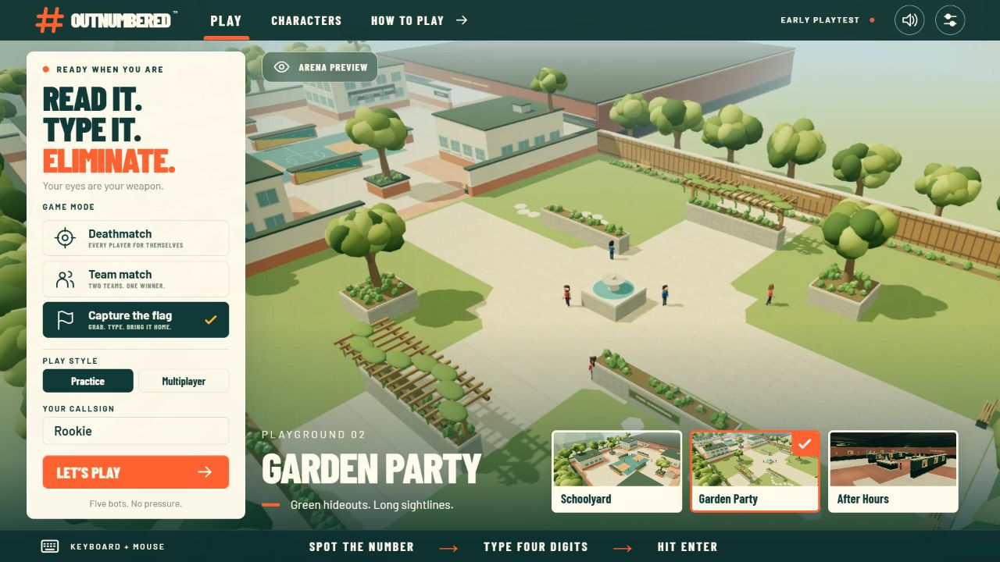</a>

*An original playable prototype. No account required. Keyboard, mouse, and touch controls.*

</div>

> **Start here:** Open the **[live game](https://outnumbered-henna.vercel.app)** and choose **Practice with bots** for an immediate match against five bots. The hosted demo is best suited to practice; [deployment notes](#vercel-deployment) explain the multiplayer limits.

---

[Overview](#the-game) · [Screenshots](#in-game-gallery) · [Playgrounds](#three-connected-playgrounds) · [Controls](#controls) · [Setup](#run-locally) · [Validation](#validation) · [Art direction](#art-direction) · [Technical docs](#technical-documentation)

## The game

Your number is visible to everyone except you. Read an opponent’s forehead, remember the four digits, and submit them before they do the same to you. Use cover, binoculars, snapshots, and distractions to create an opening.

| Three ways to compete | One shared world |
| --- | --- |
| **Deathmatch** — every player is a target | **Three connected playgrounds** with streamed 3D detail |
| **Team Deathmatch** — coordinate against the other color | **Up to 20 players per room**, with shareable room codes |
| **Capture the Flag** — steal, return, and defend | **Bot practice** for an immediate solo session |

## How to play

1. **Get a good look.** Move through the arena and read an opponent’s four-digit number. Keep your own forehead out of sight.
2. **Make it count.** Type the digits and press **Enter**. Visible opponents, or opponents seen within the last six seconds, can be eligible targets.
3. **Create an opening.** Zoom with binoculars, capture a five-second photo, or use flash, smoke, and distraction grenades.

The server checks range, visibility, cover, teams, spawn protection, and guessing cooldowns. A photograph preserves what you saw; it does not reveal hidden players.

## In-game gallery

Repository captures from different development stages; the deployed demo may differ from the latest local graphics refresh. Performance readouts in screenshots are individual captures, not benchmarks.

| First-person play | Character detail |
| :---: | :---: |
| 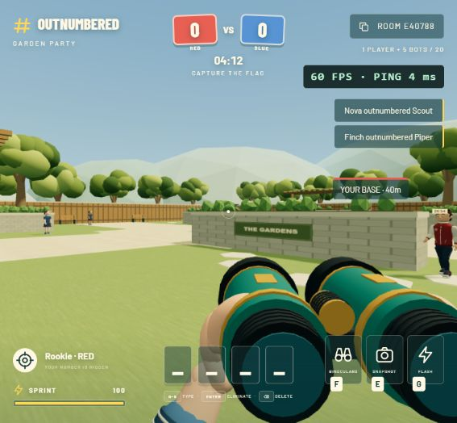 | 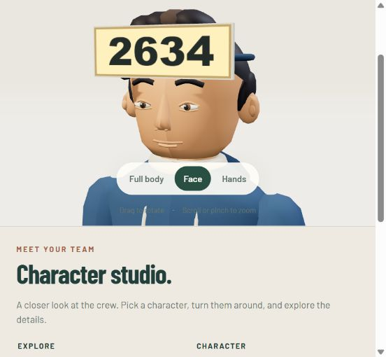 |
| **Observation, movement, and gadgets** | **Original procedural character models** |
| 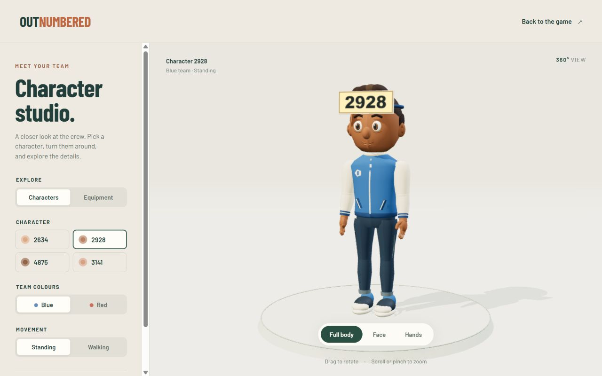 | 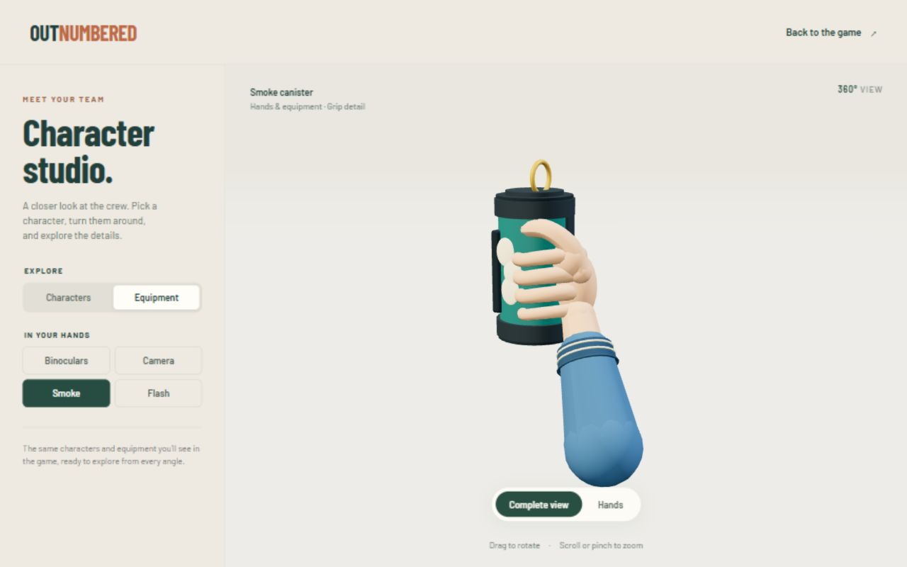 |
| **Interactive character studio** | **Hands and equipment** |

<details>
<summary><strong>Explore the screenshot archive · earlier development captures</strong></summary>

Earlier development captures document the evolution of the interface and rendering.

| Lobby | Gameplay |
| :---: | :---: |
|  |  |
| 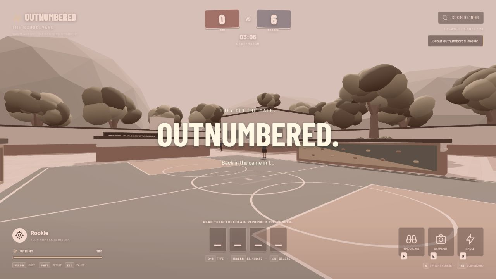 | 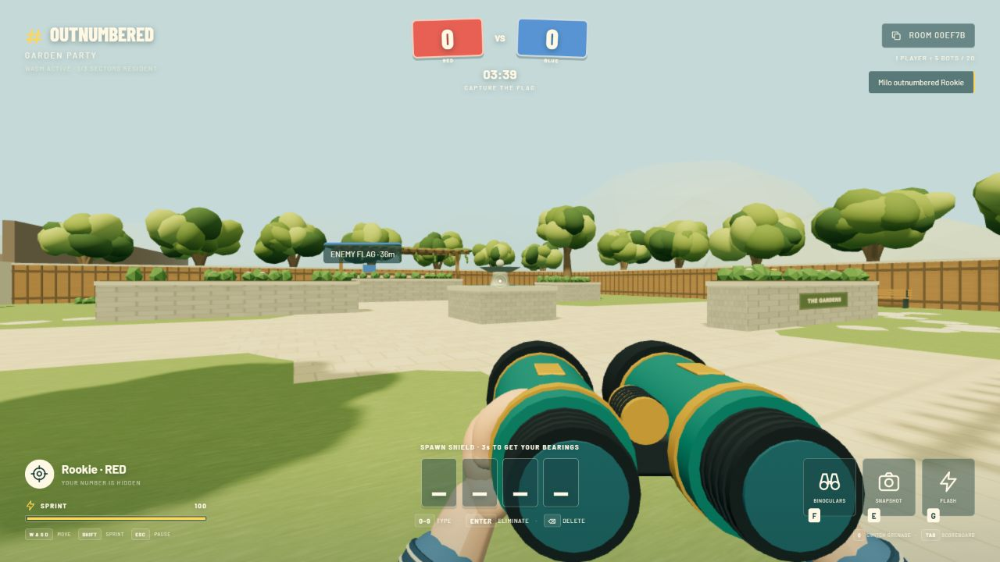 |

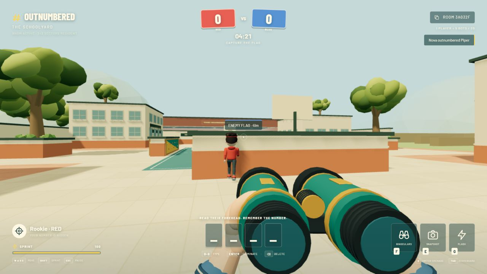

The [optimized lobby capture](docs/screenshots/optimized-lobby.jpg) is featured at the top of this README.

</details>

## Three connected playgrounds

Choose your starting area in the lobby. All three environments remain reachable during a match.

| The Schoolyard | Garden Party | After Hours |
| :---: | :---: | :---: |
| 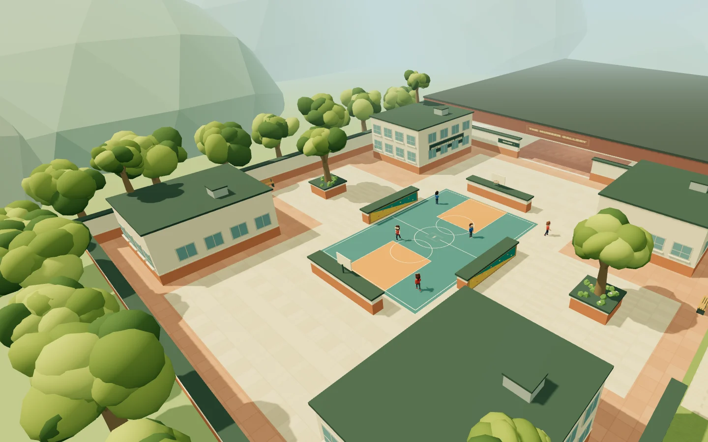 | 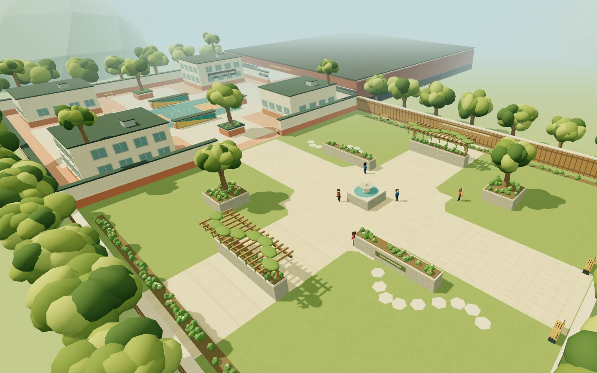 | 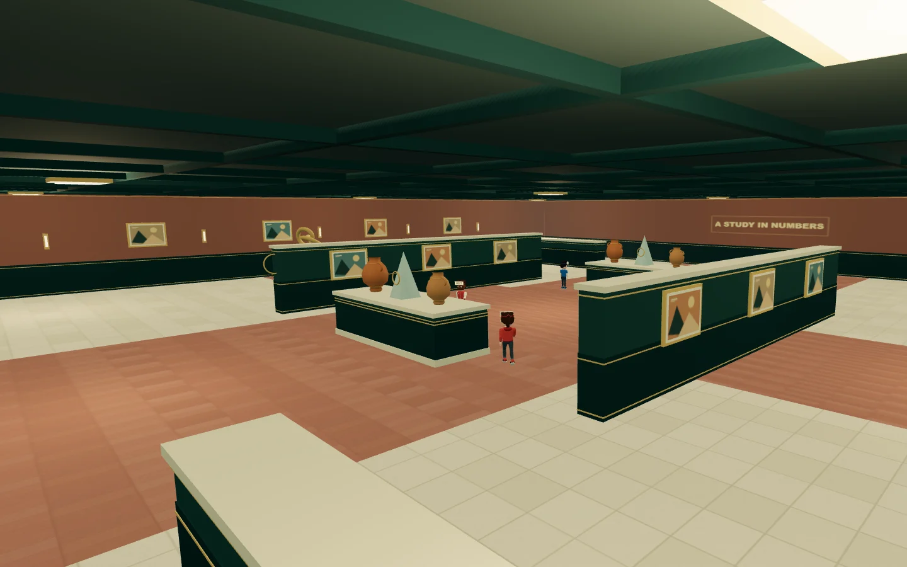 |
| School buildings, courts, and climbing-wall scenery | Foliage, pergolas, and garden sightlines | An explorable museum interior and exhibits |

---

## Run locally

Use Node.js **22.12 or newer**.

```sh
npm install
npm run dev
```

Open **http://localhost:5173**. The command builds the WASM core if needed and runs the website and match server together. Pick **Practice with bots** for an immediate match against five bots. Play with a keyboard and mouse or the on-screen touch controls.

Choose **Characters** in the lobby, or open **http://localhost:5173/characters.html**, to inspect the playable cast. The studio includes four hairstyles, varsity jackets, hoodies, polos, a pleated skirt variant, five-digit hands, articulated walking, team colors, and close-up equipment grips. Drag to rotate and use **Face** or **Hands** to inspect the details. The studio uses the same models as matches and is also included in the production build.

For a compiled build:

```sh
npm run build
npm start
```

Open **http://localhost:3001**. This single server serves the built site, WASM binary, and WebSocket connections. Set `PORT` to change the production port. Development uses ports 5173 and 3001.

## Play with friends

1. All players open the same running server.
2. Select **Multiplayer**, choose a mode and starting playground, and leave the room code blank to find/create a public match.
3. The room code appears at the top right while playing. Pause with Esc to click and copy it.
4. Friends select Multiplayer and enter that code. The host’s mode and playground are adopted automatically.

Each room supports **20 players**, with server-enforced capacity. Practice rooms are separate from public matchmaking. A link such as `http://localhost:5173/?room=ABC123` prefills the room code; use your server’s actual address for other devices. Localhost only reaches your own machine. Internet play requires hosting this Node/WebSocket server behind HTTPS/WSS.

## Vercel deployment

Import this repository into Vercel. The checked-in `vercel.json` builds the Vite website and deploys `api/game.ts` as the WebSocket/API entry point. Node.js 22 and Fluid compute are required (Fluid compute is enabled by default on new projects). No environment variables are required.

The Vercel Hobby deployment uses **four-minute rounds** to leave time for results before the 300-second WebSocket connection limit; local and Docker deployments retain five-minute rounds. Return to the lobby to start a new match after a connection closes.

Rooms currently live in server memory. Vercel can route different clients to different instances, so public matchmaking, room listings, and joining friends are **not guaranteed across instances**. This deployment is suitable for trying the prototype and bot practice. Reliable multiplayer at scale requires shared room coordination or a persistent game-server host. See [Vercel's WebSocket lifecycle and state guidance](https://vercel.com/docs/functions/websockets).

## Controls

| Control | Action |
| --- | --- |
| WASD | Move |
| Mouse | Look (drag to look if pointer lock is unavailable) |
| Arrow keys | Alternative look controls |
| Shift | Sprint; consumes recovering stamina |
| Space | Jump |
| 0–9 / numpad | Enter a four-digit number |
| Enter | Submit the number |
| Backspace | Delete a digit |
| F / right mouse | Toggle binocular zoom |
| E | Photograph your view; photo lasts five seconds |
| Q | Cycle flash, smoke, and distract grenades |
| G | Throw selected grenade |
| Tab (hold) | Scoreboard |
| Esc | Release mouse / pause menu |

Your own number is hidden. Correct guesses eliminate eligible opponents within range who are visible or were seen in the last six seconds. Forehead orientation, solid cover, smoke, team membership, spawn protection, and guessing cooldowns are checked by the server. The camera preserves a still image for reading and recall; it does not reveal hidden opponents.

On phones and tablets, drag the left stick to move and swipe the right side to turn. At default sensitivity, a half-screen swipe turns 180 degrees; zoom reduces sensitivity for precise reading. Settings → Look sensitivity adjusts turning speed. Mouse input remains available on hybrid devices.

Use **Full screen** in the lobby or pause menu to hide browser navigation where supported. Exit using the same button or the browser’s exit gesture. On iPhone browsers without document fullscreen, use Share → Add to Home Screen and launch the saved app.

## Included

- **Deathmatch**, **Team Deathmatch**, and **Capture the Flag** with five-minute rounds, scores, respawns, and results.
- Public rooms, shareable codes, and bot practice. No accounts are needed.
- Three connected original environments: **The Schoolyard**, **Garden Party**, and **After Hours**. Playground selection chooses the spawn area; all three remain reachable during play.
- Procedural school buildings, courts, climbing walls, foliage, pergolas, museum exhibits, signs, animated characters, and modeled equipment. The reference screenshots are not embedded as game graphics.
- Binoculars, camera snapshots, flash blindness, persistent smoke that blocks reading, and distraction decoys that attract bots.
- Synthesized audio, stamina, first-person prop movement, elimination effects, a scoreboard, and saved graphics/audio/mouse settings.
- True distance-based imports and GPU resource disposal. The HUD shows resident sectors.

## Architecture and streaming

This is a **hybrid WASM web game**, not a whole engine compiled to one binary. AssemblyScript compiles movement, swept collision, range math, and stamina into `public/wasm/outnumbered.wasm`. Both browser prediction and the authoritative server use that core. TypeScript handles networking, menus, input, and procedural Three.js/WebGL 2 rendering.

The lobby uses lightweight arena images and loads no 3D engine. The renderer and WASM binary are requested only when entering a match. Each detailed arena is a separate module imported as the player approaches; distant detail is disposed while inexpensive silhouettes and all collision bounds remain available. Auto graphics balances resolution and shadows against sustained frame times; High keeps sharper rendering and full-rate shadows. Geometry, textures and character detail are retained in every setting. See [the streaming design](docs/wasm-streaming.md).

```text
assembly/                WebAssembly source
public/wasm/             Compiled binary and readable WAT
src/main.ts              Lobby, dialogs, settings
src/game/game.ts         Client, controls, rendering, HUD
src/game/world.ts        Spatial streaming and lighting
src/game/zones/          Original procedural 3D environments
src/game/avatar.ts       Character meshes, articulated animation, lifecycle
src/game/equipment.ts    Equipment and five-digit first-person grips
src/character-studio.ts  Interactive inspection of the playable models
src/shared/              Map geometry and network protocol
server/index.ts          Match simulation and static hosting
tests/                   WASM, world, and WebSocket integration tests
```

## Validation

The in-match HUD displays FPS and measured WebSocket round-trip ping in milliseconds. Yellow/red indicate slow frames or high latency, and a stalled-snapshot warning distinguishes a connection interruption from rendering load. Hover over the readout for frame interval, draw calls, triangles, and graphics settings. FPS measures presentation intervals, not GPU execution time.

Opponent rendering uses a 100ms snapshot buffer and holds the last known pose during network stalls. Walk cycles advance with distance traveled and ease into idle. Bots follow collision-cleared patrol routes with bounded turns instead of choosing random escape directions. Movement key changes are sent immediately, alongside the regular 20Hz updates.

Characters have revised adult proportions, smaller eyes, shaped noses and restrained streetwear colors. They remain original procedural, stylized assets rather than GTA-quality scanned or hand-authored models. The character studio includes a wireframe inspection mode and triangle/mesh counts. Across the twelve `Portrait-0` through `Portrait-11` fixtures, average character geometry fell from 19,496 to 12,870 triangles and meshes from 27.8 to 16; these are geometry/draw-submission savings, not an FPS benchmark or a claim about deployed Vercel latency.

```sh
npm run typecheck
npm test
npm run build
```

Tests cover actual WASM collision/stamina behavior, clear spawns and movement, dynamic scene loading/unloading and resource disposal, rendered model geometry, WebSocket capacity, number validation, team rules, gadgets, flag objectives, room invitations, and safe static file serving. Browser checks cover the lobby and first-person play. A 20-client test verifies room connectivity/capacity; it is not a geographic latency or production load benchmark.

## Prototype boundaries

This is a playable foundation, not a finished commercial release. Characters are original procedural stylized meshes with layered clothing, shaped faces and modeled fingers; environments remain simpler than the references. School wings are solid cover; the museum is an explorable interior. Bots use lightweight steering rather than a navmesh. Rooms and results are in memory and disappear on server restart. No accounts, ranked progression, persistence, voice chat, or production matchmaking infrastructure are included.

The server validates gameplay, but opponent numbers are sent to connected clients for rendering; a modified client can inspect them. Production anti-cheat would need per-observer visibility replication, authentication, abuse controls, deployment monitoring, and internet latency testing.

Technical references: [Three.js renderer](https://threejs.org/docs/pages/WebGLRenderer.html), [AssemblyScript compiler](https://www.assemblyscript.org/compiler.html).

## Art direction

These **AI-generated concept sheets are visual development references**, not screenshots or a promise of the current game's rendering quality. The playable characters and environments use procedural geometry. See the [character skill sheet](docs/art-direction/v1/CHARACTER-SKILL-SHEET.md) for the modeling brief and [generation prompts](docs/art-direction/v1/PROMPTS.md) for provenance.

<details>
<summary><strong>Character design collection · 4 reference sheets</strong></summary>

| Cropped varsity | Ponytail polo |
| :---: | :---: |
| 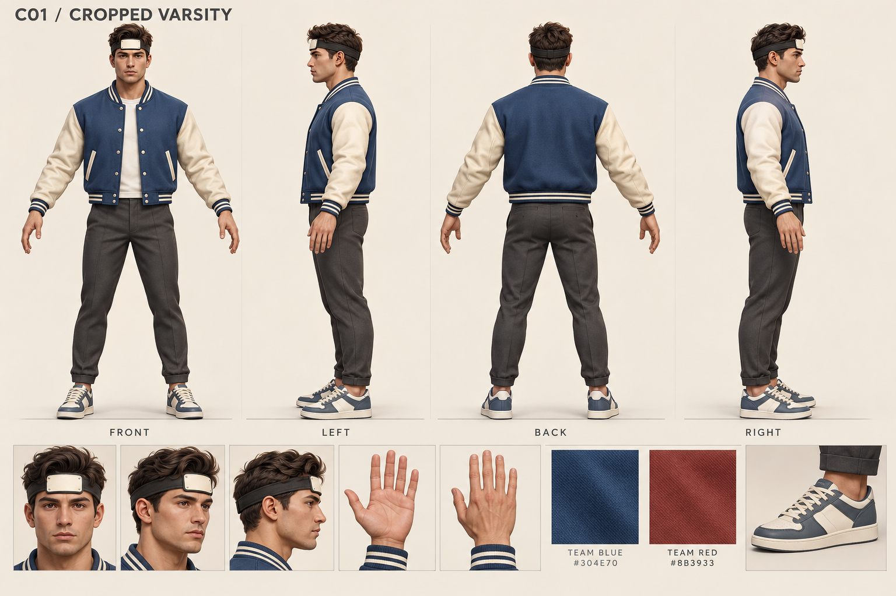 | 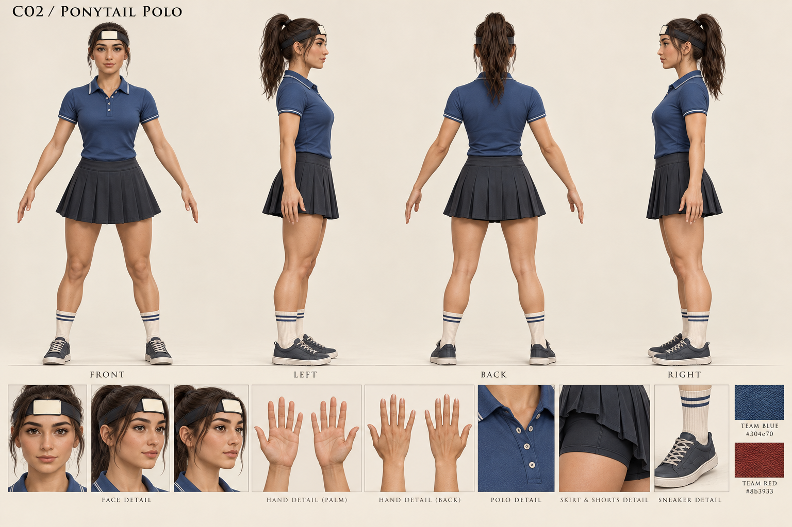 |
| **Curly hoodie** | **Swept polo** |
| 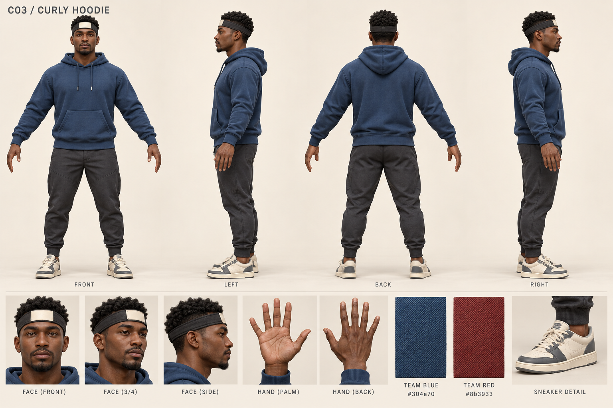 | 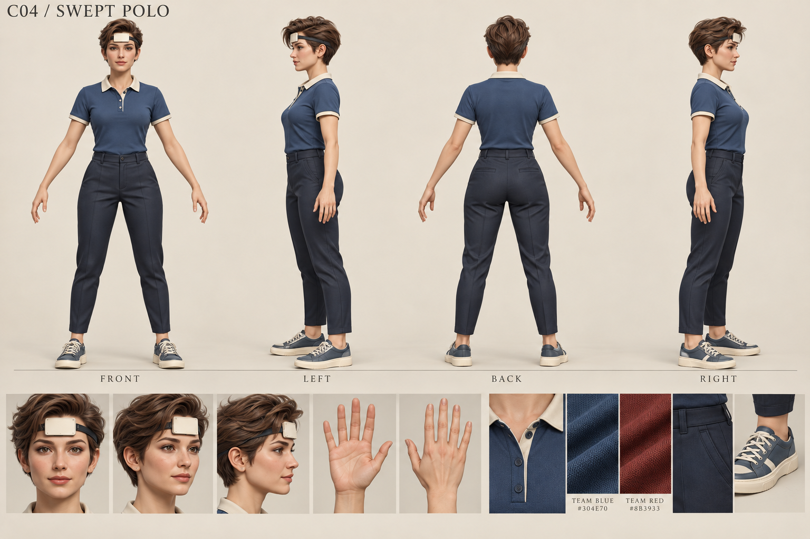 |

</details>

<details>
<summary><strong>Environment collection · 3 reference sheets</strong></summary>

### The Schoolyard — environment concept

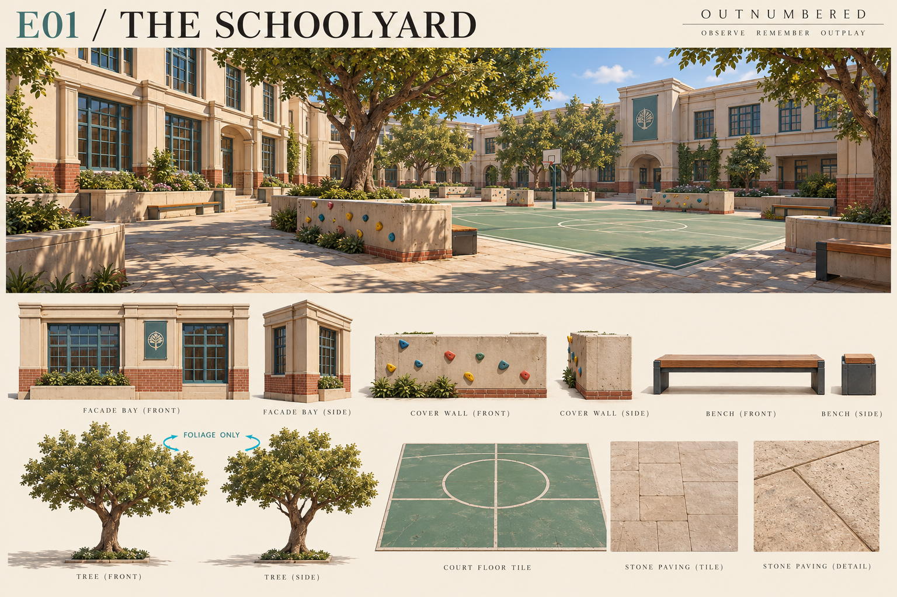

### Garden Party — environment concept

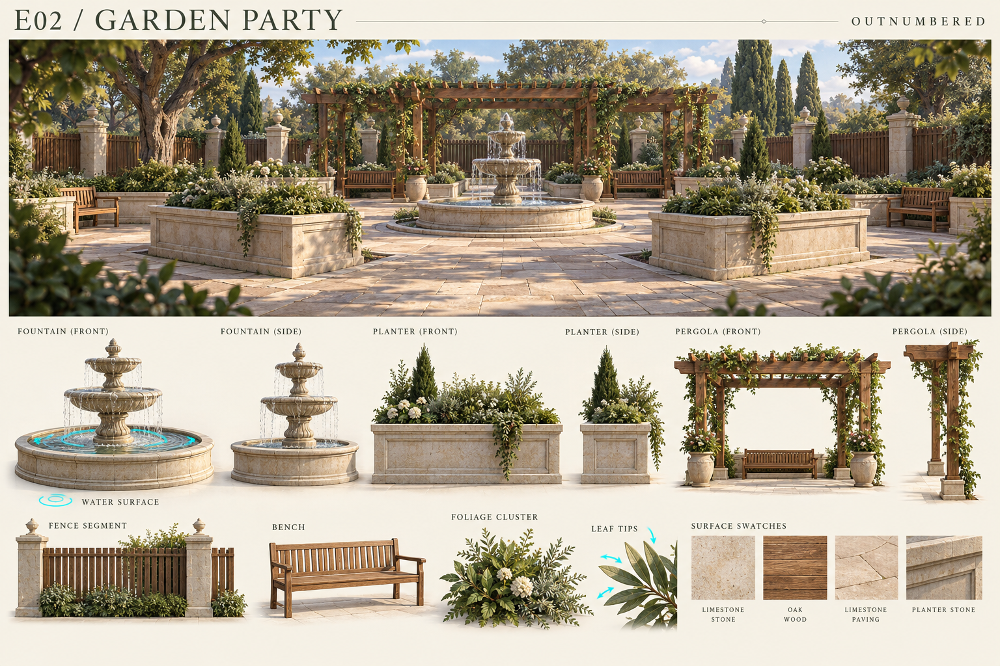

### After Hours — environment concept

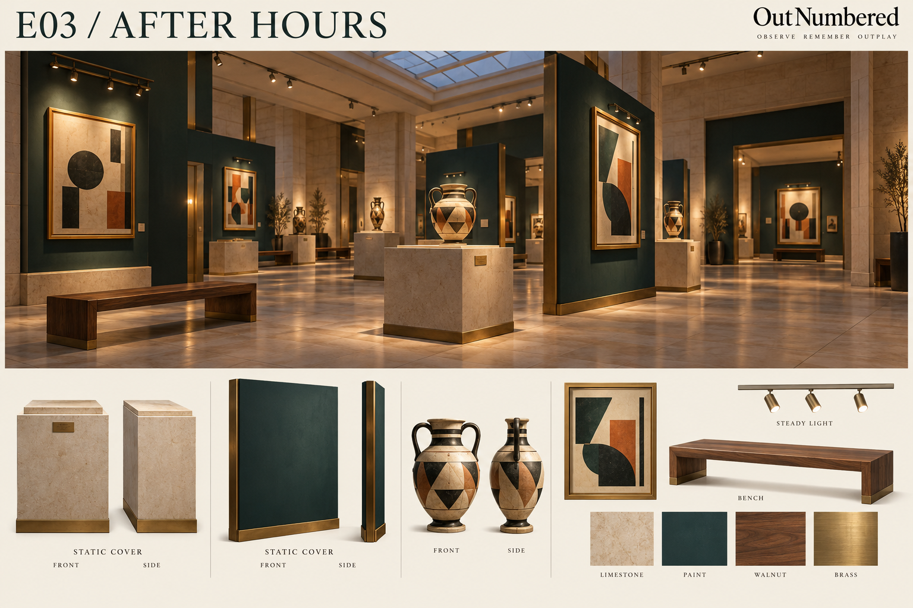

</details>

<details>
<summary><strong>Props and movement · 2 reference sheets</strong></summary>

### Team flags — prop concept

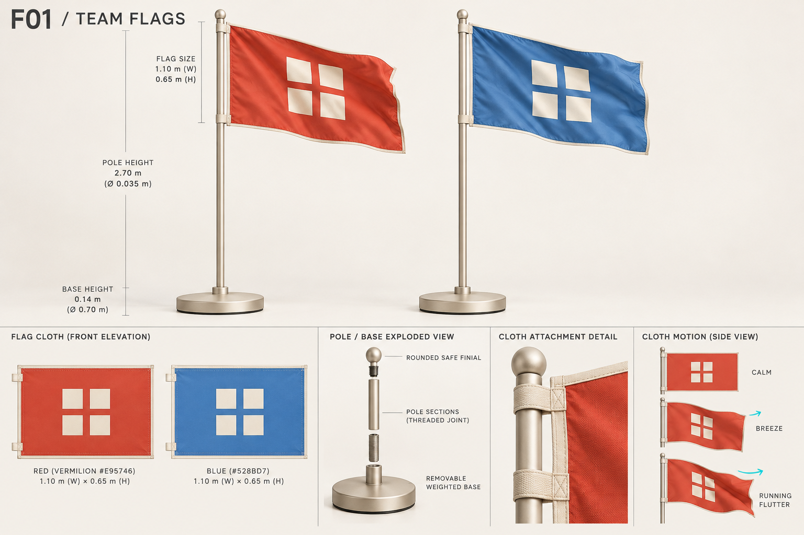

### Movement and grips — animation reference

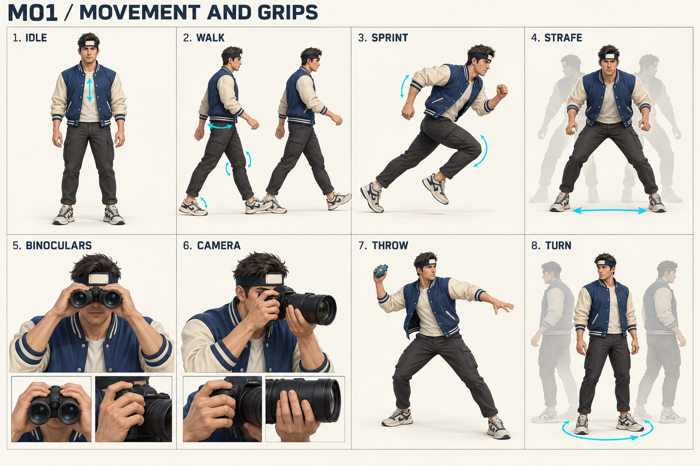

</details>

## Technical documentation

| Guide | What it covers |
| --- | --- |
| [WASM and streaming](docs/wasm-streaming.md) | Shared simulation core and world streaming design |
| [Verification notes](docs/verification.md) | Recorded checks, deployment evidence, and limitations |
| [Character refresh](docs/character-refresh.md) | Character geometry and rendering changes |
| [Character reference implementation](docs/character-reference-implementation.md) | Translating visual references into procedural models |
| [Graphics refresh](docs/graphics-refresh.md) | Material, lighting, and detail improvements |

---

<div align="center">

**Your eyes are your weapon.**

### [Play OutNumbered →](https://outnumbered-henna.vercel.app)

[Back to top](#outnumbered)

</div>
