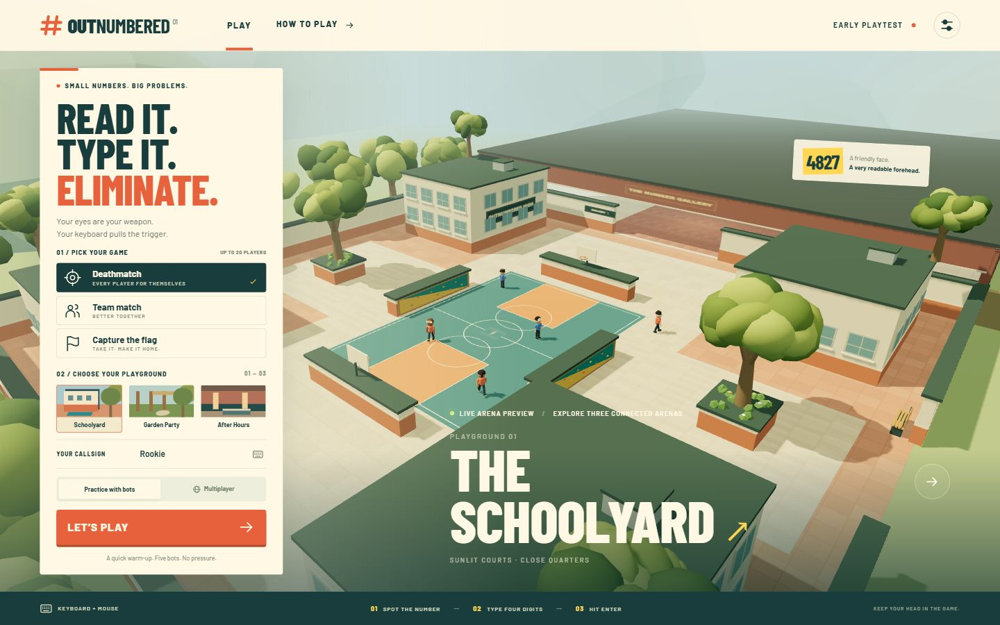
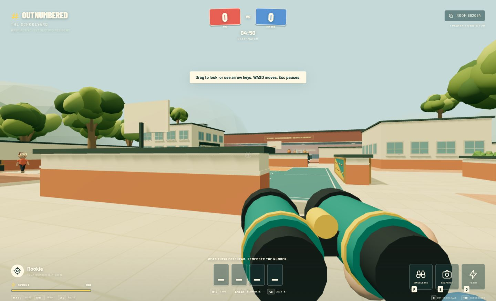

# Verification

Verified on October 11, 2026 in the local Windows environment.

## Automated checks

- `npm run build`: passed AssemblyScript compilation, strict TypeScript checking, and the Vite production build.
- `npm test`: **25 tests passed** — 6 WASM tests, 9 WebSocket/server tests, 4 world/asset tests, and 6 character regression tests.
- The multiplayer capacity test connected 20 real WebSocket clients and rejected the 21st.
- The CTF integration test used real movement inputs around obstacles to verify pickup, carrier elimination/flag return, and capture.
- Streaming tests verified concurrent request deduplication, load/unload/reload, and geometry/material/texture disposal.

## Browser checks

The compiled application was served by `npm start` at `http://localhost:3001` and tested using the in-app Chromium browser.

- Schoolyard, garden, and museum previews rendered without console errors.
- Network observation showed the initial lobby loading only campus detail. Garden detail was requested when selected. The WASM binary was requested upon joining a match.
- Practice joined one human and five server-controlled bots.
- Keyboard digit entry, camera capture and expiry, binocular zoom, grenade selection/cooldown, sprint stamina, pause, and leaving a match worked.
- CTF rendered team identity and flag objective markers.
- Two independent browser tabs joined the same real multiplayer room, showed two players, and correctly adopted the invited room’s team mode.
- At 1440 × 900, the final practice lobby fit without vertical or horizontal overflow. The narrow browser layout also rendered responsively.

The browser’s pointer-lock restriction activated the intended drag-to-look/arrow-key fallback. Native pointer-lock capture should also be exercised in the target release browsers.

The character refresh was also inspected in the interactive studio and a live practice match. See [character details and validation](character-refresh.md).

## Known limits

This validates a playable local prototype. The 20-client test is not a distributed latency/performance benchmark. No internet hosting, production anti-cheat, or public load testing was performed. Procedural artwork is intentionally simpler than the supplied references. Docker packaging is supplied but was not executed in this environment.

Vite reports a size advisory for the separately loaded Three.js engine chunk (~515 kB minified, ~131 kB gzip); the arena detail modules remain separate (~3 kB each). This advisory does not fail the build.

